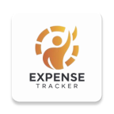
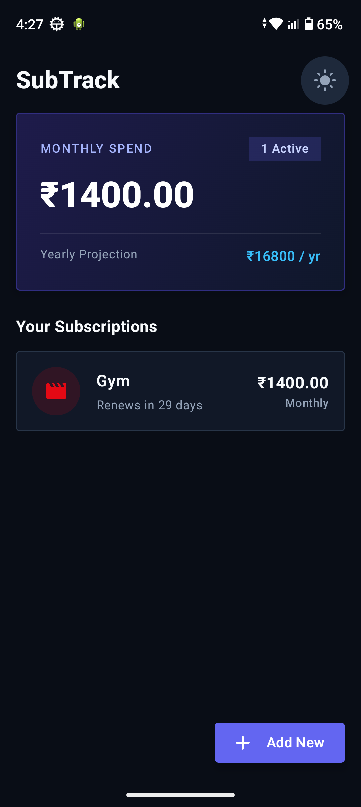
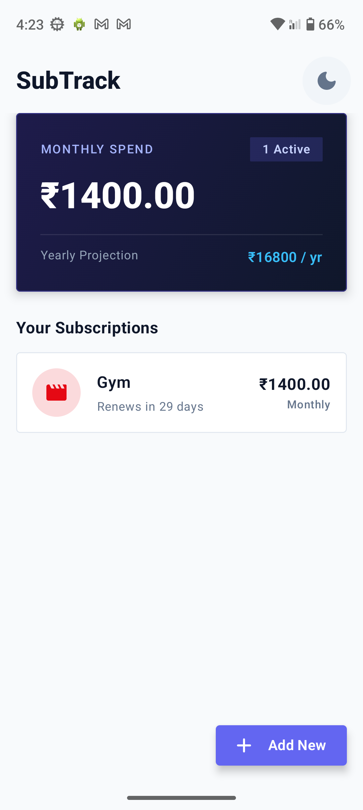
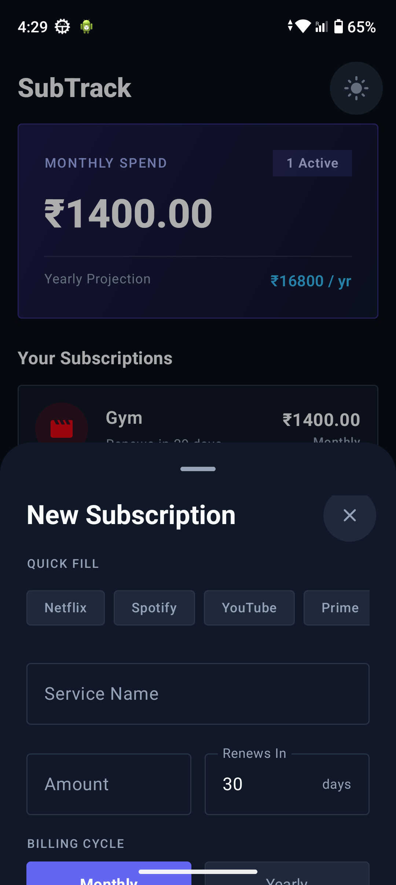
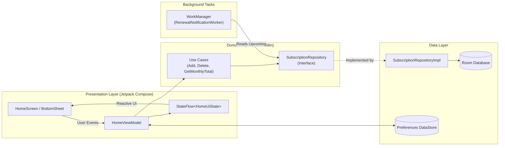

<div align="center">

<!-- App Logo / Banner -->


# SubTrack
### Minimalist Subscription & Recurring Expense Manager

*Track smarter. Cancel faster. Never get surprised by a renewal charge again.*

[](https://kotlinlang.org)
[](https://developer.android.com/jetpack/compose)
[]()
[](https://dagger.dev)
[](https://developer.android.com/training/data-storage/room)

<br/>

[📥 Download Latest APK](SubTrack-Debug.apk) • [🐛 Report Bug](https://github.com/RaviYadavO4/SubTrack/issues) • [✨ Request Feature](https://github.com/RaviYadavO4/SubTrack/issues)

</div>

---

## 🎯 Overview

**SubTrack** is an offline-first, privacy-focused Android application crafted with **100% Kotlin** and **Jetpack Compose**. Built around a modern **Midnight Obsidian & Electric Indigo** fintech design language, it gives users instant clarity over their monthly cash burn, category-level spending distribution, and upcoming billing cycles.

> **Why I built this:** Managing scattered subscriptions across streaming, fitness, and cloud utilities is tedious. SubTrack demonstrates production-grade Android engineering practices—combining reactive UI streams, clean domain separation, and reliable background scheduling in a lightweight package.

---

## 📱 Visual Showcase

<div align="center">

| 🌑 Midnight Dark Mode | ☀️ Crisp Light Mode | ⚡ One-Tap Quick Add |
| :---: | :---: | :---: |
|  |  |  |
| *Default fintech dark theme with category breakdown* | *Persistent light theme powered by DataStore* | *Smart presets with instant brand color & pricing* |

</div>

---

## ✨ Standout Features

| Feature | Engineering & UX Highlight |
| :--- | :--- |
| **📊 Live Financial Projections** | Normalizes both **Monthly** and **Yearly** billing cycles in real time to display accurate monthly burn and annual spend estimates. |
| **🎨 Animated Spending Breakdown** | Multi-segment animated horizontal bar (`animateFloatAsState`) illustrating percentage spend across *Entertainment*, *Fitness*, *Utility*, and *Work*. |
| **⚡ One-Tap Quick Presets** | Pre-configured chips for *Netflix, Spotify, Prime, YouTube, Gym, and iCloud+* auto-fill pricing, category, and brand accent colors. |
| **👆 Gesture-Driven UX** | Smooth **Swipe-to-Delete** with instant **Snackbar Undo** recovery to prevent accidental data loss. |
| **🌓 Persistent Theme Engine** | Seamless Dark/Light mode toggle backed by **Jetpack Preferences DataStore**, surviving app restarts without flickering. |
| **🔔 Automated Renewal Alerts** | Daily periodic background checks via **WorkManager** + `HiltWorker` trigger local notifications 24 hours prior to renewal. |

---

## 🏗 Architecture & Data Flow

SubTrack adheres strictly to **Clean Architecture** and **Unidirectional Data Flow (UDF)**, ensuring testability, scalability, and zero UI-layer business logic.



---

## 🛠 Tech Stack

- **Core:** Kotlin, Coroutines, Reactive `Flow` & `StateFlow`
- **UI & Design:** Jetpack Compose, Material Design 3, Custom Theme & Typography, Compose Animations
- **Architecture:** MVVM + Clean Architecture (Presentation, Domain, Data)
- **Dependency Injection:** Dagger Hilt (`@HiltViewModel`, `@HiltWorker`)
- **Local Persistence:** Room Database (SQLite abstraction), Jetpack Preferences DataStore
- **Background Scheduling:** AndroidX WorkManager (`CoroutineWorker`)

---

## 📂 Package Structure

```text
com.portfolio.subtrack
├── 📂 data
│   ├── 📂 local          # Room Entity, DAO, Database & DataStore ThemePreferences
│   └── 📂 repository     # Repository Implementation & Entity <-> Domain Mappers
├── 📂 di                 # Dagger Hilt Dependency Injection Modules
├── 📂 domain
│   ├── 📂 model          # Core Domain Models (Subscription, BillingCycle, Category)
│   ├── 📂 repository     # Repository Contracts (Interfaces)
│   └── 📂 usecase        # Single-Responsibility Business Logic Use Cases
├── 📂 presentation
│   ├── 📂 components     # SummaryCard, CategoryBreakdownCard, ItemCard, BottomSheet
│   ├── 📂 home           # HomeScreen, HomeViewModel & HomeUiState (UDF)
│   └── 📂 theme          # Midnight Obsidian & Crisp Light Color Schemes
└── 📂 worker             # WorkManager Daily Renewal Alert Worker
```

---

<details>
<summary><b>⚙️ Click to expand: Build & Local Setup Instructions</b></summary>

<br/>

1. **Clone the repository**
   ```bash
   git clone https://github.com/RaviYadavO4/SubTrack.git
   cd SubTrack
   ```
2. **Open in Android Studio**
   - Launch **Android Studio (Ladybug 2024.2+ recommended)**.
   - Select **File → Open** and choose the cloned `SubTrack` directory.
3. **Build & Run**
   - Allow Gradle to sync dependencies automatically.
   - Run on an Android Emulator or physical device running **Android 7.0 (API 24)** or higher.

</details>

---

## 🗺 Roadmap

- [ ] **Multi-Currency Switcher:** Support for `₹`, `$`, `€`, and `£` with formatting localization.
- [ ] **CSV / PDF Export:** Generate monthly expense statements for personal bookkeeping.
- [ ] **Biometric App Lock:** Optional Fingerprint / Face ID protection using `androidx.biometric`.
- [ ] **Unit & UI Tests:** Comprehensive JUnit4, Turbine (Flow testing), and Compose UI test coverage.

---

<div align="center">

### 👨‍💻 Developed by **Ravi Yadav**

[](https://github.com/RaviYadavO4)
[](https://linkedin.com)

*If you found this project helpful or inspiring for your Android journey, consider giving it a ⭐!*

</div>
